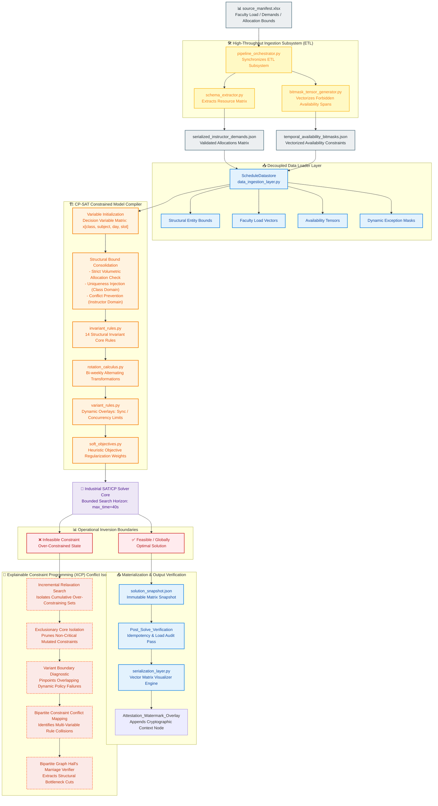
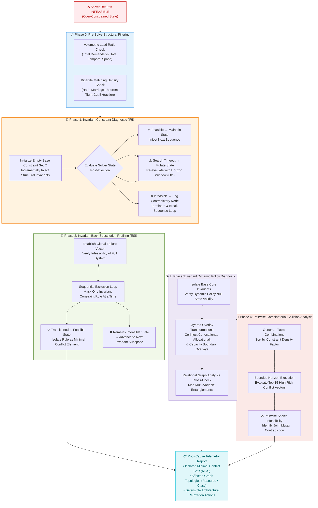

# Explainable Combinatorial Timetabling & Automated Conflict Refinement Engine

© 2026. All rights reserved.

> **Notice:** The production source code, specific constraint heuristics, and underlying database schemas of this optimization system are hosted in a secure, private repository due to proprietary intellectual property protections and ongoing commercial deployment. This public repository functions exclusively as a high-level architectural specification, theoretical formalization, and methodology showcase for graduate school application portfolios. Unauthorized duplication, modification, or commercial exploitation of these designs is strictly prohibited.

---

## 1. Architectural Philosophy & The Core Challenge
Industrial-grade constraint solvers (such as Google OR-Tools CP-SAT) are highly efficient at navigating dense search spaces. However, when real-world requirements become over-constrained, the solver outputs a binary, uninformative `INFEASIBLE` state. In practical scenarios—such as K-12 institutional scheduling involving complex overlapping human and physical resource constraints—this "black box" failure mode leaves operators without actionable diagnostic insights.

This project implements an **Explainable Constraint Programming (XCP)** architecture. Instead of treating explanation as a superficial post-hoc layer, this system embeds diagnostic logic into the compilation and state-evaluation pipelines. It automatically isolates root-cause contradictions, extracts **Minimal Unsatisfiable Subsets (MUS)**, and provides human-readable feedback to enable defensible relaxation choices.

---

## 2. High-Level Modular Topology

The system decoupled the data ingestion, configuration parsing, CP-SAT model compilation, and the explainable diagnostic pipeline into distinct boundaries to handle NP-hard computational scale cleanly.

```mermaid
graph TB
    classDef entry_node fill:#e3f2fd,stroke:#1e88e5,stroke-width:2px,color:#0d47a1;
    classDef ui_node fill:#f1f8e9,stroke:#558b2f,stroke-width:2px,color:#2e7d32;
    classDef core_node fill:#fff3e0,stroke:#f57c00,stroke-width:2px,color:#e65100;
    classDef crypto_node fill:#ffebee,stroke:#d32f2f,stroke-width:2px,color:#b71c1c;
    classDef data_node fill:#eceff1,stroke:#607d8b,stroke-width:2px,color:#263238;
    classDef pipeline_node fill:#fff9c4,stroke:#fbc02d,stroke-width:2px,color:#f57f17;

    subgraph Entry["🚪 System Ingestion Entry"]
        MAIN["runtime_orchestrator.py<br/>Application Entry"]:::entry_node
        LAUNCHER["ui_bootstrapper.py<br/>Asynchronous UI Bootstrapper"]:::entry_node
    end

    subgraph GUI["🖥️ Human-in-the-Loop Control Console"]
        RUNNER["optimization_dashboard.py<br/>Solver Real-Time Console"]:::ui_node
        RESPONSIVE["viewport_adapter.py<br/>Dynamic Layout Engine"]:::ui_node
        EDITOR["constraint_manifest_editor/<br/>Rule Configuration Interface"]:::ui_node
        
        subgraph TABS["📋 Constraint Config Panels"]
            TAB_DASH["diagnostic_telemetry<br/>Pre-solve Diagnostic Console"]
            TAB_SWAP["dynamic_mutation<br/>Manual Overrides & Swapping"]
            TAB_SYNC["temporal_alignment<br/>Slot Synchronization Panel"]
            TAB_RESTRICT["forbidden_spans<br/>Restricted Spans Layout"]
            TAB_CONCUR["capacity_bounds<br/>Concurrency Boundary Config"]
            TAB_LOCKED["anchored_slots<br/>Locked Temporal Slots"]
            TAB_STRICT["resource_compaction<br/>Curriculum Density Recommender"]
            TAB_PREF["spatial_preference<br/>Location Affinity Matrix"]
            TAB_STAB["schedule_stability<br/>Stability Preservation Constraints"]
            TAB_CONSEC["consecutive_blocks<br/>Block Scheduling Weights"]
            TAB_TEACHER["instructor_load<br/>Faculty Load Distribution Optimization"]
            TAB_ROTATE["interleaved_rotation<br/>Alternating Bi-weekly Rotation"]
        end
    end

    subgraph Scheduler["🧠 Explainable Constraint Programming Core"]
        CONST["system_manifest.py<br/>Global Envs & Asset Constants"]:::core_node
        LOADER["data_ingestion_layer.py<br/>Unified Schedule Datastore"]:::core_node
        RULES["primitive_constraints.py<br/>Atomic Constraint Operators (8 Primitives)"]:::core_node
        CFIX["invariant_rules.py<br/>Structural Hard Constraints (14 Invariants)"]:::core_node
        VAR["variant_rules.py<br/>User-Defined Variant Rules"]:::core_node
        ROT["rotation_calculus.py<br/>Bi-weekly Interleaved Operations"]:::core_node
        PREF["soft_objectives.py<br/>Heuristic Preference Weights"]:::core_node
        BUILD["model_compiler.py<br/>CP-SAT Model Compiler & Solver Engine"]:::core_node
        DIAG["conflict_diagnostics.py<br/>Pre/Post-Infeasibility Diagnostic Engine"]:::core_node
        TGRAPH["bipartite_instructor_graph.py<br/>Bipartite Topology & Graph Relational Mapper"]:::core_node
        SWAP["mutation_engine.py<br/>Stateful Conflict-Free Swapping Engine"]:::core_node
        WEEK["temporal_calendar.py<br/>Temporal Matrix Calculator"]:::core_node
        EXPORT["serialization_layer.py<br/>Matrix Result Exporter"]:::core_node
    end

    subgraph Application["🔗 Architectural Bridge Layer"]
        STARTUP["lifecycle_manager.py<br/>Lifecycle State Machine"]:::crypto_node
        PERM["security_context.py<br/>RBAC & Scope Evaluator"]:::crypto_node
    end

    subgraph Licensing["🔐 Cryptographic Attestation Subsystem"]
        LMODEL["attestation_schema.py<br/>Cryptographic Identity Struct"]:::crypto_node
        VERIFY["ed25519_sign_validator.py<br/>Digital Signature Verification"]:::crypto_node
        MACHINE["hardware_fingerprint.py<br/>Hardware Fingerprint Synthesis"]:::crypto_node
        ACTIVATE["node_binding_orchestrator.py<br/>Hardware-Node Cryptographic Binding"]:::crypto_node
        AUDIT["tamper_proof_audit.py<br/>Cryptographic Auditing Records"]:::crypto_node
    end

    subgraph Data["📊 Schema Storage & Asset Lake"]
        RAW["raw/source_manifest.xlsx"]:::data_node
        GEN["intermediate/<br/>Serialized Graph Model"]:::data_node
        RULESDIR["policy_rules/<br/>JSON Encrypted Policies"]:::data_node
    end

    subgraph Tools["🛠️ Continuous Data Extraction Pipeline"]
        PREPARE["pipeline_orchestrator.py<br/>ETL Ingestion Engine"]:::pipeline_node
        PARSER["schema_extractor.py<br/>Relational Data Extractor"]:::pipeline_node
        BITMASK["bitmask_tensor_generator.py<br/>Bitmask Vector Generation"]:::pipeline_node
        GENREQ["requirement_synthesizer.py<br/>Demand Matrix Synthesizer"]:::pipeline_node
    end

    MAIN --> LAUNCHER
    MAIN -.-> STARTUP
    LAUNCHER --> RUNNER
    LAUNCHER --> EDITOR
    EDITOR --> TABS
    
    STARTUP --> LMODEL
    STARTUP --> PERM
    LMODEL --> VERIFY
    LMANAGER --> MACHINE
    LMANAGER --> ACTIVATE
    LMANAGER --> AUDIT

    RUNNER --> BUILD
    RUNNER --> PERM
    BUILD --> LOADER
    BUILD --> CFIX
    BUILD --> VAR
    BUILD --> ROT
    BUILD --> PREF
    BUILD --> RULES
    BUILD --> DIAG
    BUILD --> EXPORT
    
    TABS --> RULESDIR
    EDITOR --> Data
    DIAG --> TGRAPH
    DIAG --> SWAP
    
    PREPARE --> PARSER
    PREPARE --> BITMASK
    PARSER --> RAW
    BITMASK --> RAW
    PREPARE --> GEN
    GEN --> LOADER
    RULESDIR --> VAR
    RULESDIR --> CFIX
    RULESDIR --> PREF

    EXPORT --> Data
```

---

## 3. End-to-End Optimization & Diagnostic Flow
Data-level inputs are vectorized into high-density tensors before entering the CP-SAT compiler. If structural invariants or dynamic policy overlays collide, the control flow is instantly routed into an isolation sequence.

4. Deep-Dive: Advanced Infeasibility Diagnosis Pipeline

When the solver hits an unsat condition, the system launches a multi-tiered search architecture to systematically isolate the minimal conflicting core without causing search state explosions.

• Phase 0 (Pre-Solve Fast Pass): Extracts structural bottlenecks via graph density bounds (Hall's Condition cuts) before invoking the heavy solver loop.

• Phase 1 (Incremental Relaxation Injection): Progressively builds the hard constraint matrix to capture the earliest point of structural failure under a variable timeout window.

• Phase 2 (Exclusionary Subspace Isolation): Evaluates constraint deletion effects to mathematically isolate individual non-negotiable rule requirements.

• Phase 4 (Pairwise Combinatorial Collision): Ranks and tests high-density policy tuples to capture multi-variable mutex lockouts efficiently.
